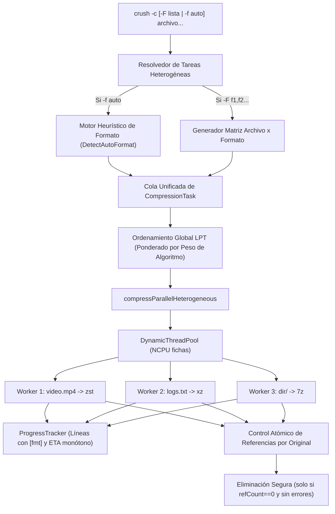

# Especificación de Diseño: Compresión Heterogénea en Crush

**Fecha:** 2026-10-26  
**Estado:** Aprobado  
**Alcance:** Compresión concurrente multi-formato (`-F`) y modo adaptativo automático (`-f auto`)

---

## 1. Contexto y Objetivos

Actualmente, `crush` soporta 13 formatos de compresión y paralelismo automático `NCPU()`. Sin embargo, al comprimir en múltiples formatos (`-F fmt1,fmt2`), la ejecución procesa los formatos de manera secuencial (primero todo en formato 1, luego formato 2, etc.), dejando núcleos de CPU ociosos cuando los archivos terminan a destiempo. Además, todos los archivos de un lote se comprimen obligatoriamente bajo el mismo algoritmo a menos que se invoque el comando múltiples veces.

### Objetivos Principales:
1. **Matriz Concurrente Multi-Formato (`-F`):** Permitir que las tareas $(archivo_i \times formato_j)$ se procesen de forma simultánea e independiente en una sola cola paralela gobernada por `DynamicThreadPool`, eliminando tiempos muertos entre formatos y saturando el 100% de los núcleos del procesador.
2. **Modo Adaptativo Automático (`-f auto`):** Detección inteligente del formato óptimo de compresión analizando el contenido y la naturaleza de cada archivo/directorio (ej. texto/código $\to$ `xz`/`7z`, multimedia o ya comprimidos $\to$ `zstd`, directorios $\to$ `7z`/`tar.xz`).
3. **Preservación Segura de Archivos Originales (`KeepOrig`):** Garantizar mediante conteo de referencias atómico que un archivo original jamás sea eliminado hasta que **todas** sus variantes de compresión hayan concluido con éxito.
4. **Visibilidad en Terminal:** Cada worker reporta claramente el nombre del archivo y el formato que está generando en tiempo real en `ProgressTracker`.

---

## 2. Arquitectura del Sistema



---

## 3. Estructuras de Datos

### 3.1 `CompressionTask`
En `compress.go`:
```go
type CompressionTask struct {
    ID            int          // Identificador único de tarea
    File          string       // Ruta del archivo o directorio origen
    Format        Format       // Formato objetivo asignado (gz, xz, 7z, zst, etc.)
    Size          int64        // Tamaño en bytes del origen (recursivo para directorios)
    ThreadCap     int          // Límite óptimo de hilos (bloques, RAM, herramientas)
    OutPath       string       // Ruta final calculada del archivo comprimido
    IsLastForFile bool         // Indica si es la última tarea activa para este fichero origen
}
```

### 3.2 Soporte de Formato `Auto`
En `format.go`:
- Se añade el valor especial `Auto` al enum `Format` (`Format = 14`).
- Se registra `"auto"` en `formatNames` y en `ParseFormat`.
- Cuando `Auto` está presente, `DetectAutoFormat(path string)` resuelve el formato concreto en tiempo de ejecución.

---

## 4. Motor Heurístico del Modo Adaptativo (`DetectAutoFormat`)

`DetectAutoFormat(path string) Format` implementa una decisión pura basada en la stdlib:

1. **Directorios:**
   - Si `hasTool(sevenzBin())` $\to$ `SevenZ` (`.7z`), aprovechando compresión sólida multi-archivo y soporte de contraseñas.
   - Si no $\to$ fallback a `Zst` (`.tar.zst`) si `zstd` está instalado, o `Gz` (`.tar.gz`).
2. **Archivos Multimedia o Pre-Comprimidos (Baja Reducción):**
   - Extensiones: `.mp4`, `.mkv`, `.avi`, `.mov`, `.mp3`, `.flac`, `.aac`, `.jpg`, `.jpeg`, `.png`, `.webp`, `.zip`, `.gz`, `.xz`, `.bz2`, `.zst`, `.7z`, `.rar`, `.iso`, `.pdf`.
   - Asignación: `Zst` (`.zst`). Provee throughput ultra-rápido (>400 MB/s) sin malgastar CPU en algoritmos pesados que no pueden comprimir datos ya entrópicos.
3. **Archivos de Texto, Código, Datos y Ejecutables (Alta Reducción):**
   - Extensiones: `.txt`, `.log`, `.csv`, `.tsv`, `.json`, `.xml`, `.html`, `.css`, `.js`, `.ts`, `.c`, `.cpp`, `.h`, `.go`, `.rs`, `.py`, `.java`, `.sh`, `.sql`, `.tar`, `.bmp`, `.bin`, `.dat`.
   - Asignación: `Xz` (`.xz`) o `SevenZ` (`.7z`), maximizando ratio con LZMA2.
4. **Archivos sin Extensión o Desconocidos:**
   - Lectura de los primeros 512 bytes: si contiene bytes no imprimibles o alta densidad de bytes nulos $\to$ `Zst`; si es texto plano UTF-8/ASCII $\to$ `Xz`.

---

## 5. Planificación y Balanceo Concurrente Heterogéneo

1. **Expansión y Deduplicación:**
   - Para cada archivo o carpeta de entrada, se resuelven sus formatos destino:
     - Si `-f auto`: se invoca `DetectAutoFormat(item)`.
     - Si `-F auto,xz,zst`: se evalúa `auto` y se añaden los formatos explícitos.
   - Se crea una tarea por cada combinación única $(archivo, formato)$.
2. **Ordenamiento LPT Ponderado:**
   - `LPTWeight(task) = task.Size * FormatComplexityWeight(task.Format)`.
   - Los compresores lentos y pesados (`xz`, `7z`, `bz3`) con archivos grandes se despachan de primero para que no queden rezagados al final de la cola.
3. **Cálculo Individual de Hilos (`ThreadCap`):**
   ```go
   cap := MaxEffectiveThreads(task.Format, task.Size)
   cap = MemorySafeMaxThreads(task.Format, cap)
   fmtMax := FormatMaxThreads(task.Format)
   if cap > fmtMax { cap = fmtMax }
   task.ThreadCap = cap
   ```
4. **Ejecución Dinámica:**
   - Si el número total de tareas $\le maxWorkers$, se pre-asignan los hilos con `AllocateThreadsProportionalWithCaps`.
   - Si supera la ventana concurrente, cada worker solicita fichas al `DynamicThreadPool` pasando su `task.ThreadCap` y liberándolas al terminar.

---

## 6. Preservación y Limpieza Segura (`KeepOrig`)

- Se inicializa un mapa seguro concurrente:
  `pendingTasks := make(map[string]*atomic.Int32)`
  donde cada archivo de origen cuenta con el número de formatos pendientes.
- Al terminar un worker:
  - Si la tarea falló, se marca el archivo como `failed[task.File] = true`.
  - Se decrementa el contador `pendingTasks[task.File].Add(-1)`.
  - Si el contador llega a `0`, no hubo ningún error para ese archivo y `!opts.KeepOrig`:
    se elimina el archivo o carpeta original de forma segura.

---

## 7. Reporte Visual en Tiempo Real (`ProgressTracker`)

- Cada `FileProgress` se nombra con el formato visible:
  `fmt.Sprintf("%s [%s]", filepath.Base(task.File), task.Format.String())`
- La barra de progreso de cada worker se actualiza de forma independiente (bien sea por pipe streaming `countingReader`, porcentaje de la herramienta externa o sondeo de disco `pollFileProgress`).
- Al concluir, el resumen total indica la cantidad de archivos comprimidos generados agrupados por formato.

---

## 8. Estrategia de Pruebas (TDD)

1. **`format_test.go`:**
   - `TestParseFormat_Auto`: parseo de flag `"auto"`.
   - `TestDetectAutoFormat`: tabla de casos cubriendo texto (`.txt`), video (`.mp4`), ya comprimido (`.zip`), y directorios.
2. **`compress_test.go`:**
   - `TestHeterogeneousCompression_Matrix`: compresión de archivos a múltiples formatos concurrentes (`-F gz,xz,zst`) verificando que todos los archivos resultantes existan y sean válidos.
   - `TestHeterogeneousCompression_AutoMode`: compresión de un lote mixto (texto + video dummy) con `-f auto` verificando la extensión de salida generada.
   - `TestHeterogeneousCompression_KeepOrigSafety`: verificación de que el archivo original no se elimina si uno de los formatos falla o mientras queden formatos pendientes.
   - `TestHeterogeneousCompression_ProgressFormatting`: verificar etiquetas `[fmt]` en `FileProgress`.
3. **Integración con Detector de Carreras (`-race`):**
   - Asegurar que la concurrencia en `pendingTasks`, `DynamicThreadPool` y `ProgressTracker` opere libre de data races.

---

## 9. Documentación a Actualizar

- `AGENTS.md`: Registro de la nueva capacidad de compresión heterogénea en la sección de características y convenciones de paralelismo.
- `COMPRESOR.md`: Incorporación de `-f auto` y matriz multi-formato concurrente en la lista de funcionalidades implementadas.
- `README.md`: Ejemplos de uso de `crush -c -f auto ...` y `crush -c -F gz,xz,zst ...`.
- Ayuda CLI (`main.go / printHelp`): Descripción del modo `-f auto` y lista de formatos.
